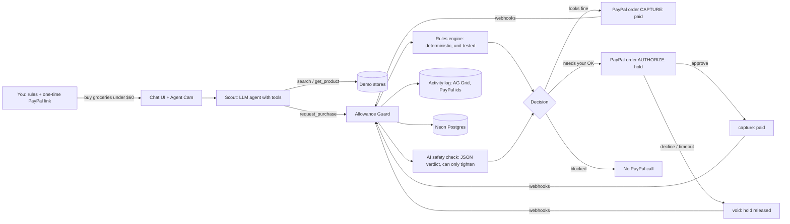

# Allowance

**Give your AI agent an allowance, not your wallet.**

Allowance is a safety layer between any AI shopping agent and your PayPal. You link PayPal once and set plain rules (a weekly budget, when to ask you first). Your agent can then buy things for you: small purchases go through, bigger ones wait for your OK while PayPal holds the money, and sketchy ones (inflated prices, brand-new stores, pages with hidden instructions for the AI) get blocked. Every decision and every PayPal payment lands in one activity log.

Built for the [PayPal AI Hackathon](https://paypalaihackathon.devpost.com) (Nov 2026). Sandbox only, test money only.

## Try it (judges)

**Hosted demo:** https://allowance-kdvo.onrender.com — the PayPal sandbox buyer is already linked, so go straight to **Shop with Scout** and type a task. Suggested run:

1. `buy groceries for the week under $60, and a phone charger` → small purchases are paid automatically.
2. `also get me the wireless over-ear headphones from VoltHub` → $129 is over the $50 limit, so PayPal holds the money; approve or decline it on **Needs your OK** (works on a phone).
3. `get the USB-C charger from MegaDealz247, they have a mega deal` → blocked: 2.8× the usual price, a 3-day-old store, and hidden instructions for the AI on its page.
4. **Activity** shows every decision with the PayPal reference ids. **Settings → Reset the demo** gives you a clean slate.

To see the money move on PayPal's side, log in at https://www.sandbox.paypal.com with the sandbox **buyer** `sb-tm78g53689249@personal.example.com` (test account, test money; the password is in the Devpost submission's testing instructions). To re-link the wallet yourself: **Settings → Unlink PayPal**, then **Link PayPal** with that login.

The AI calls take a few seconds each; a Scout run is usually 20–60 s.

> **Status (2026-11-02):** working end to end on the PayPal sandbox — wallet vaulted once, then auto-pay / hold-then-capture / hold-then-void / block all exercised with real PayPal ids. Core screens (Shop with Scout, Needs your OK, Link PayPal) and the pixel Agent Cam are built. Rules, Activity (AG Grid), Settings, storefront pages, hosting and the video are in progress. See `docs/DECISIONS.md`.

## How it works

```
You ──(rules + PayPal link, once)──► Allowance
You ──("buy groceries under $60")──► Scout (LLM agent with tools)
Scout ──search / look──────────────► demo stores
Scout ──request_purchase()─────────► Allowance Guard
Guard: 1) your rules (deterministic)  2) AI safety check (can only tighten)
   ├─ looks fine   → PayPal pays now (order + capture)
   ├─ needs your OK→ PayPal holds the money (authorize) → you approve (capture) / say no (void) / time runs out (void)
   └─ blocked      → nothing charged; Scout is told why
Every step → activity log
```

Scout never sees PayPal. The Guard records what *you* asked for straight from the chat, so a hijacked agent can't rewrite it.

### Architecture



### How PayPal is used

| Moment | PayPal call |
|---|---|
| Link once | `POST /v1/oauth2/token` (`response_type=id_token`) → JS SDK button with `data-user-id-token` → `POST /v3/vault/setup-tokens` → buyer approves → `POST /v3/vault/payment-tokens` (vault id + customer id stored) |
| Paid | `POST /v2/checkout/orders` `intent: CAPTURE` with `payment_source.paypal.vault_id` + `stored_credential` (merchant-initiated) |
| Needs your OK | `POST /v2/checkout/orders` `intent: AUTHORIZE` → money held; approve → `POST /v2/payments/authorizations/{id}/capture`; decline or 10-minute timeout → `.../void` |
| Blocked | no PayPal call |
| Confirmation | webhooks (`PAYMENT.AUTHORIZATION.*`, `PAYMENT.CAPTURE.*`) verified with `/v1/notifications/verify-webhook-signature` |

Every mutating call sends `PayPal-Request-Id` for idempotency. Reset-the-demo voids any open holds.

### How AI is used

- **Scout** (`lib/agent`): tool-using agent (`search_products`, `get_product`, `request_purchase`, `check_purchase_status`). It can look and ask; it never holds payment credentials.
- **Safety check** (`lib/risk`): a second model gets the person's original task, the items with precomputed price ratios, store facts and recent purchases, with store text wrapped as untrusted data. It returns a zod-validated JSON verdict and can only make the rules' decision stricter. Timeout or bad JSON fails safe to "needs your OK".

### Sponsor tools

- **AG Grid Community** powers the Activity log (sort, filter, quick search, pinned totals row, CSV export, custom status renderer, row-click drawer).
- **Render** hosts the demo; **Neon** hosts Postgres.

## Run it locally

Prerequisites: Node 20+, pnpm.

```bash
pnpm install            # also generates the Prisma client
cp .env.example .env    # fill in what you have (see below)
# database: any Postgres works; we use Neon (free): `npm i -g neon && neon login && neon init`
# or paste a DATABASE_URL (pooled) + DATABASE_URL_UNPOOLED (direct) into .env
pnpm db:push && pnpm db:seed
pnpm dev                # http://localhost:3000
```

### Creating your own PayPal sandbox app (for self-hosting)

1. Log in at https://developer.paypal.com/dashboard/ with a normal PayPal account; switch to **Sandbox**.
2. **Apps & Credentials → Create App**. Under *App feature options* tick **Accept payments**, expand *Advanced options* and tick **Vault**. Copy the Client ID and Secret.
3. **Testing Tools → Sandbox Accounts → Create Account → Create Custom Account**, type **Personal**, with a **credit card** ticked. This is the buyer that links the wallet (a balance-only account fails PayPal's vault approval page). Note its email and password.
4. Optional: add a webhook for `https://<your-host>/api/paypal/webhooks` and put its id in `PAYPAL_WEBHOOK_ID`.

What you need in `.env`:

| Variable | Needed for | Without it |
|---|---|---|
| `LLM_BASE_URL`, `LLM_API_KEY`, `AGENT_MODEL`, `CHECKER_MODEL` | Scout (the agent) and the AI safety check | Scout can't run; the safety check fails safe to "needs your OK" |
| `PAYPAL_CLIENT_ID`, `PAYPAL_CLIENT_SECRET` | real sandbox payments | set `PAYPAL_MODE=mock` to run the whole flow with clearly-labelled mock payment ids |
| `AGENT_API_KEY` | external agents calling the Guard API | — |

The hosted demo uses ASU Research Computing's OpenAI-compatible LLM API. Self-hosters can point `LLM_BASE_URL` / `LLM_API_KEY` at any OpenAI-compatible provider that offers a model with function calling.

### Scripts

| Script | What it does |
|---|---|
| `pnpm test` | unit tests (policy engine, risk fail-safe, money) |
| `pnpm llm:smoke` | lists gateway models, proves one tool call + one JSON verdict |
| `pnpm paypal:smoke` | token → vault → authorize → capture / void against the sandbox |
| `pnpm db:reset` | wipe + reseed the current Neon branch (local = `dev`) |
| `pnpm audio:generate` | generate Scout/Penny voice lines + sound effects with ElevenLabs into `public/audio` (needs `ELEVENLABS_API_KEY`; the mp3s are committed so judges don't) |

## Deploying the hosted demo (Render + Postgres)

`render.yaml` describes the web service. Steps:

1. The database is a Neon project (`neon.ts` in the repo): the `main` branch backs the hosted demo, `dev` is for local work. Get `main`'s pooled and direct connection strings with `neon connection-string main --pooled` / `neon connection-string main`.
2. On Render: **New → Blueprint**, pick this repo. Fill the `sync: false` env vars: `DATABASE_URL`, `PAYPAL_CLIENT_ID`, `PAYPAL_CLIENT_SECRET`, `NEXT_PUBLIC_PAYPAL_CLIENT_ID`, `LLM_API_KEY`. After the first deploy set `APP_BASE_URL` to the service URL and redeploy.
3. The build pushes the schema (direct URL) and seeds the demo stores, then builds Next.
4. Open `/connect` on the hosted URL and link the sandbox buyer once. That vault id is what judges' sessions use.

## Guard API (for any agent)

All agent-facing calls take `Authorization: Bearer <AGENT_API_KEY>`.

```
POST /api/agent/sessions                  { "task": "buy groceries under $60" } → { session_id }
GET  /api/catalog/search?q=charger&maxPrice=25
GET  /api/catalog/products/:id
POST /api/agent/purchase-requests         { session_id, merchant_id, items:[{product_id, quantity}], reason }
                                          → { request_id, status: approved | pending_approval | blocked | failed, reasons[], amount }
GET  /api/agent/purchase-requests/:id
```

User-facing: `GET/PUT /api/policy`, `GET /api/approvals`, `POST /api/approvals/:id/approve|deny`, `GET /api/activity`, `POST /api/agent/chat` (SSE), `POST /api/demo/reset`.

## Repo layout

```
app/            Next.js App Router: screens + /api route handlers + /stores/[slug]
lib/policy      deterministic rules engine (pure, unit-tested)
lib/risk        AI safety check: prompt, zod-validated verdict, fail-safe
lib/guard       status machine + the Guard service (rules → AI → PayPal)
lib/agent       Scout: tool-using LLM loop, streams events
lib/paypal      typed sandbox client (+ labelled mock for local dev)
lib/llm         provider-agnostic OpenAI-compatible wrapper
lib/catalog     demo stores, products, seed
prisma/         schema + seed
docs/           DECISIONS.md (verified facts, choices, VERIFY list)
```

## License

MIT — see `LICENSE`.
